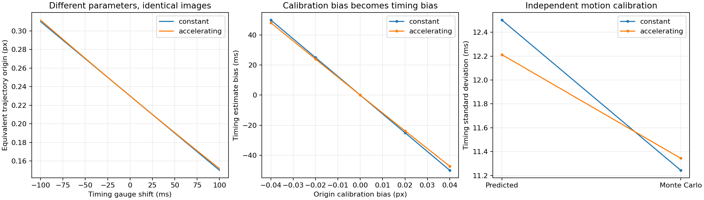

# Motion calibration and shutter timing learning lab

A 45–60 minute lesson: can a camera distinguish its timestamp offset from an unknown moving-spot trajectory? Connect Gaussian diffraction, finite pixels, asymmetric exposure, joint parameter fitting and an exact ambiguity. **Acceleration does not remove the ambiguity when both origin and velocity are free.** Independent motion calibration supplies the missing time reference.

## Run

Python 3.9–3.12 and a POSIX shell; internet is needed for the initial pinned dependency installation:

```sh
git clone https://github.com/ahmetalpkilic/motion-calibration-timing-learning-lab.git
cd motion-calibration-timing-learning-lab
sh run_demo.sh
```

The command creates `.venv`, runs seven tests and writes `outputs/results.json` and `outputs/experiment.png`. Later, `.venv/bin/python lab.py` runs offline. Seeded synthetic data only; reference outputs are in `examples/`. Floating-point details may vary across platforms.



## Objectives and prerequisites

Prerequisites: Gaussian integration, least squares, Jacobians and covariance; the [asymmetric shutter lesson](https://github.com/ahmetalpkilic/asymmetric-shutter-timing-learning-lab) supplies the known-trajectory baseline.

Learn to derive a time-origin ambiguity, check it in full camera images, jointly fit five physical parameters with independent calibration, and distinguish image agreement from accurate physical timing. Spend 10 minutes on the derivation, 10 running the lab, 15 reading the annotated functions and 10–25 on exercises.

| Area | Model | Link to inference |
|---|---|---|
| Optics | Fourier transform of a Gaussian amplitude pupil | Diffraction width controls the moving spot's spatial profile |
| Camera | Finite pixels, weighted global exposure, read noise | Integrates space and time before sampling |
| Vision/metrology | Fit optical width, shutter asymmetry, timestamp offset, origin and speed | Motion calibration makes physical timing locally identifiable |
| Mathematics | Exact parameter symmetry, Jacobian null vector, Fisher covariance | Explains why additional images cannot fix a missing reference |

## Physical model and conventions

Wavelength λ=550 nm, focal length f=16 mm, pitch p=4 µm. Pupil amplitude is A(r)=exp(−r²/(2s²)), with s=f/(2N). True N=8 gives s=1 mm. N is a **Gaussian pupil scale**, not a hard circular f-number; the untruncated pupil produces a Gaussian PSF, not an Airy pattern.

The one-dimensional signal is a marginal of a separable two-dimensional PSF, integrated over all y. Pixel centers j=−8,…,8 increase rightward; edges are j±0.5. Equivalent intrinsics: fx=fy=4000 px, zero skew/distortion, centered principal point (0,0), or cx=8 in the 17-column array. No depth reconstruction is attempted.

Trajectory x(t)=c+vt+at²/2 uses seconds and pixels. True c=0.23 px, v=0.8 px/s; known a=0 or 0.35 px/s². Nominal frame midpoints are −1,−1,0,0,1,1 s, with durations 0.4 and 1.2 s at each midpoint. Actual time is t_nominal+δ+Tu, u∈[−1/2,1/2], with δ=0.04 s. Shutter weight w(u)=1+2αu has α=0.6; its integral is one and it is nonnegative for |α|≤1.

Each exposure has fixed integrated flux F=10000 ADU and background B=20 ADU/pixel. This requires adjusted illumination across durations. Independent Gaussian read noise has SD=2 ADU/pixel; shot noise, saturation and quantization are excluded. One independent calibration pair per experiment measures c and v in an external clock's reference frame, with SDs 0.01 px and 0.02 px/s. Calibration errors are mutually independent and independent of image noise. Durations, acceleration, pitch, wavelength and photometry are known exactly.

## Derivation

Fourier transforming A and squaring the amplitude gives intensity proportional to exp(−4π²s²x²/(λf)²). Matching a Gaussian density gives

```text
σ_length = λf/(sqrt(8)πs) = λN/(sqrt(2)π)
σ_pixel  = λN/(sqrt(2)πp) ≈ 0.2476 px.
P_j(x,N) = Φ((j+0.5−x)/σ_pixel) − Φ((j−0.5−x)/σ_pixel)
μ_kj = B + F ∫ (1+2αu) P_j(c+vq+aq²/2,N) du,
q = t_k+δ+T_k u,  integral over −1/2 ≤ u ≤ 1/2.
```

`image` evaluates the Gaussian CDF pixel integral and 32-point Gauss–Legendre time integral. The optical profile is strongly undersampled; fitting the integrated model avoids substituting a pixel-center centroid for the continuous centroid.

For any time shift h, define

```text
δ' = δ+h
v' = v−ah
c' = c−vh+ah²/2.
```

Substitution shows c'+v'(q+h)+a(q+h)²/2 = c+vq+aq²/2. Thus **every pixel of every exposure is identical**, for arbitrary durations and nominal times, even under acceleration. Width N and asymmetry α remain unchanged. This is a structural ambiguity, not merely high correlation or lack of signal. Held-out images cannot resolve it either.

Differentiating at h=0 gives the image Jacobian null direction `(0,0,1,−v,−a)` in parameter order `(N,α,δ,c,v)`. Its rank is four for this design. Singular-value magnitudes depend on chosen units; the exact algebraic null direction is the stronger conclusion.

The independent observations z_c and z_v add residuals `(c−z_c)/0.01` and `(v−z_v)/0.02` to image residuals `(μ−data)/2`. `fit` minimizes their squared sum with physical bounds. At constant speed the origin calibration anchors timing; with acceleration the velocity calibration also contributes. In the ideal limit of noiseless images, local timing information along the ambiguity is

```text
I_δ = v²/σ_c² + a²/σ_v²
SD(δ) ≥ 1/sqrt(I_δ).
```

This local lower floor is 12.5 ms at constant speed and about 12.21 ms with acceleration. With finite image noise the full covariance is `(JᵀJ)⁻¹` for the augmented, whitened Jacobian. Known noise variances mean no residual-variance multiplier is used. This is an interior, local approximation, not a universal confidence guarantee.

## Annotated code map

- `sigma_px`: pupil scale to physical diffraction width in pixel units.
- `image`: normalized temporal quadrature, trajectory and analytic pixel integration.
- `gauge`: exact alternate physical parameters that generate identical images.
- `jacobian`: central differences of image residuals; its null vector is tested independently.
- `fit`: adds external origin/speed observations, then solves bounded least squares.
- `demo`: independently resamples both image and calibration errors, compares predicted and empirical precision, and injects systematic calibration bias.

## Controlled errors and expected results

Noiseless, unbiased calibration recovers `(8,0.6,0.04,0.23,0.8)` for both trajectories. The exact ambiguity sweep h=±100 ms changes origins and velocities while leaving images unchanged to floating-point precision. The first plot displays the equivalent origins; the JSON reports the image error and singular values.

The second plot injects origin calibration bias from −0.04 to +0.04 px. At constant velocity, +0.04 px causes **−50 ms timing bias** exactly: Δδ=−Δc/v. Images, including held-out exposures, still agree. Under acceleration both calibration observations constrain the shift, so the bias follows a compromise. A low image residual does not certify timing accuracy.

The third plot compares local timing SD with 120 independently seeded trials; exact numerical values and all five parameter SDs appear in `examples/results.json`. Held-out mean predictions use midpoints −0.5,0.5 s and durations 0.7,1.5 s. They validate implementation consistency, not an independently measured clock.

## Validation

Seven tests check signed-error RMSE, independent nested spatial/time integration and a numerical pupil Fourier transform; flux, quadrature convergence and stationary limit; exact image symmetry, rank and null vector; noiseless recovery and held-out prediction; analytic constant-speed calibration bias; and separately seeded 100-trial covariance for each trajectory. Monte Carlo spread tolerances account for finite samples. The demo also reports empirical 95% coverage without claiming exact coverage from 120 trials.

## Exercises

1. Derive the parameter transformation by expanding the quadratic. Why does known acceleration fail to provide an absolute clock reference?
2. Change calibration SDs by factors of two. Predict the timing floor before rerunning; compare with the full covariance.
3. Hold velocity externally exact. Compare a=0 and a=0.35: when can velocity calibration anchor time without origin calibration?
4. Use equal exposure durations. Inspect whether further optical/shutter ambiguities appear; distinguish those from the exact time-origin symmetry.
5. Introduce correlated origin/velocity calibration. Replace the two scalar residuals with Cholesky whitening, and derive the floor using the inverse calibration covariance.

## Sources, licenses and limits

Original MIT code extends the [MIT predecessor](https://github.com/ahmetalpkilic/asymmetric-shutter-timing-learning-lab)'s Gaussian pupil, finite-pixel and exposure conventions. No upstream optical implementation, real image data or weights are copied. Reviewed [prysm](https://github.com/brandondube/prysm) (MIT) for physical optics, [SciPy least_squares](https://docs.scipy.org/doc/scipy/reference/generated/scipy.optimize.least_squares.html) for numerical optimization, and current NumPy/SciPy/Matplotlib repositories. `sources.json` records exact reviewed commits, activity and license paths; `source-licenses/` retains full top-level notices. Runtime versions are pinned separately; their installed distributions retain bundled notices. `owner-repositories.json` records the duplicate check.

Limits: ideal untruncated Gaussian pupil, global shutter and one-dimensional marginal, known acceleration/photometry/durations/spatial scale, invariant linear shutter response and read noise only. Bounds can hide nonidentifiability if used as artificial references. Synthetic numerical recovery and repeatability do not establish instrument accuracy.

Next focused lesson: correlated motion calibration from finite reference observations, and choosing reference times to reduce timing uncertainty. This adds a physical calibration design rather than repeating independent c/v priors.
